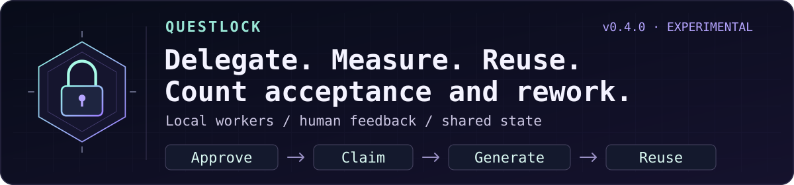

<div align="center">

# spfuzzylink

### Every abstraction is a hypothesis.

**Build something small enough to understand. Then ask it a difficult question.**

curiosity → experiment → failure → understanding

</div>

---

I’m interested in the distance between a system that works and a system whose failure I can explain.

Some questions only become clear after you build the thing. Give it a little state, a little concurrency, and an inconvenient restart. See which assumptions survive.

I like starting with the fewest moving parts I can get away with. Complexity has to earn its place. A new component should explain more than it hides.

> The most useful thing a side project can produce is a better question.

Most repositories here begin as a curiosity. Some may become useful tools. Each should leave behind a clearer understanding of how something behaves when the happy path ends.

### A few principles I keep coming back to

- Make the state visible.
- Treat failure as something to study.
- Understand the small system before growing it.
- Let evidence change the design.
- Leave enough notes for the next curious person.

---

### ☕ Currently building: Questlock



**[Questlock](https://github.com/spfuzzylink/questlock)** — a Go + SQLite experiment in making shared agent work measurable, reusable, and reviewable.

A model can pass its checks and still leave a person with work to redo.
**Experimental v0.4.0 connects declared-check results to explicit human feedback.**

- **Delegate bounded work.** Codex and Claude Code can use a local-first MCP worker with explicit context, limits, and checks.
- **Record what the reviewer decides.** Accept, rewrite, reject, or reopen the work. Every rewrite clears acceptance until explicit reacceptance identifies the final artifact digest.
- **Count the work that failed too.** A declared cohort retains recorded attempt costs and incremental review time, including rejected work. Missing cost, effort, or hourly rate stays unknown.
- **Reuse valid snapshots.** Matching completed results avoid another generation; reuse adds zero new generation usage rather than charging the original answer again.

The metric is cost per **currently human-accepted outcome in the recorded cohort**. It becomes available only with explicit review signals and complete required accounting. Configured prices are estimates, and surrounding hosted-chat usage, hardware, and unrecorded work remain separate. No passive editor watching or automatic acceptance is implied. Cohorts count task ID/revision pairs; the application defines how those map to business deliverables.
[Human feedback and accounting](https://github.com/spfuzzylink/questlock/blob/main/docs/outcomes.md) · [Runnable synthetic examples](https://github.com/spfuzzylink/questlock/tree/main/examples/outcomes).

**OpenRouter routes the model. Questlock coordinates the work.**
Credit to OpenRouter for the common provider interface and caching that inspire this companion direction, and to Langfuse for optional content-free inference observability. Direct OpenAI, Anthropic, and installed local Ollama adapters are available; a selectable OpenRouter adapter remains planned. Langfuse check scores and explicit human acceptance remain separate signals.
[Architecture and attribution](https://github.com/spfuzzylink/questlock/blob/main/docs/model-architecture.md#openrouter-inspiration-and-possible-add-on).

**[Experimental v0.4.0](https://github.com/spfuzzylink/questlock/releases/tag/v0.4.0)** supports macOS and Linux on ARM64 and x86-64. After [installing](https://github.com/spfuzzylink/questlock#start-the-quest), try:

```sh
./bin/questlock quest
./bin/questlock model quest
./bin/questlock outcome quest
```

These demos use temporary authenticated storage and deterministic fixtures, with no model account. The feedback quest covers six acceptance, rewrite, accounting, receipt, and restart scenarios. The [v0.3.0 live measurements](https://github.com/spfuzzylink/questlock/blob/main/docs/measurements-v0.3.0.md) remain visible, including failed local-model checks; reuse does not improve answer quality.

[Delegation and MCP](https://github.com/spfuzzylink/questlock/blob/main/docs/delegation.md) ·
[Langfuse setup](https://github.com/spfuzzylink/questlock/blob/main/docs/inference-observability.md) ·
[Container](https://github.com/spfuzzylink/questlock/pkgs/container/questlock) ·
[Editable feedback diagram](https://github.com/spfuzzylink/questlock/blob/main/docs/diagrams/human-outcomes.drawio) ·
[Fork a failure case](https://github.com/spfuzzylink/questlock/fork)

Small enough to inspect. Useful enough to measure.

---

<div align="center">

<sub>Curiosity starts the experiment. Evidence decides what stays.</sub>

</div>
