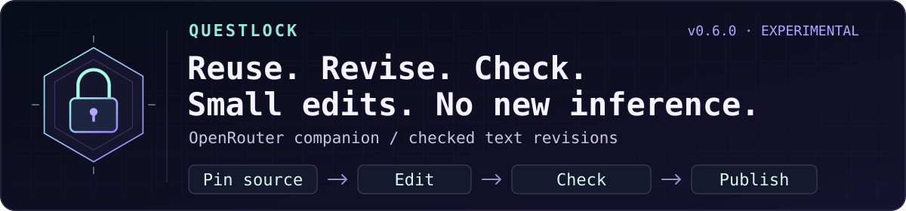

<div align="center">

# spfuzzylink

### Every abstraction is a hypothesis.

**Build something small enough to understand. Then ask it a difficult question.**

curiosity → experiment → failure → understanding

</div>

---

I’m interested in the distance between a system that works and a system whose failure I can explain.

Some questions only become clear after you build the thing. Give it a little state, a little concurrency, and an inconvenient restart. See which assumptions survive.

I like starting with the fewest moving parts I can get away with. Complexity has to earn its place. A new component should explain more than it hides.

> The most useful thing a side project can produce is a better question.

Most repositories here begin as a curiosity. Some may become useful tools. Each should leave behind a clearer understanding of how something behaves when the happy path ends.

### A few principles I keep coming back to

- Make the state visible.
- Treat failure as something to study.
- Understand the small system before growing it.
- Let evidence change the design.
- Leave enough notes for the next curious person.

---

### ☕ Currently building: Questlock



**[Questlock](https://github.com/spfuzzylink/questlock)** — a Go + SQLite experiment in making shared agent work measurable, reusable, and reviewable.

A reviewed answer often needs one precise edit. Regenerating it adds computation
and a chance of changing the claims. **Experimental v0.6.0 adds checked literal
revisions: pin the source, apply counted edits, verify the result, and publish it
without another model call.** Existing routing, runtime and human-outcome layers
remain available.

- **Revise without inference.** Exact source hashes, replacement counts and required checks guard mechanical edits. Immutable parent provenance supports follow-up changes; failed checks withhold text.
- **Coordinate bounded inference.** Codex and Claude Code can delegate checked tasks locally, or explicitly escalate through a budgeted provider tier. The OpenRouter adapter requests one declared model/provider route.
- **Inspect runtime reuse.** Standalone self-hosted SGLang dense/HiCache engines can generate bounded tasks. Runtime KV counters remain separate from provider cache billing and whole-answer reuse.
- **Record the review outcome.** Accept, rewrite, reject, or reopen the work. Every rewrite clears acceptance until explicit reacceptance; cohort costs retain failed attempts and reported review effort.
- **Reuse valid snapshots.** Matching completed results avoid another generation with zero new generation usage. A changed observed SGLang runtime stops an existing provider before stale reuse.

The metric is cost per **currently human-accepted outcome in the recorded cohort**. It becomes available only with explicit review signals and complete required accounting. Configured prices are estimates, and surrounding hosted-chat usage, hardware, and unrecorded work remain separate. No passive editor watching or automatic acceptance is implied. Cohorts count task ID/revision pairs; the application defines how those map to business deliverables.
[Human feedback and accounting](https://github.com/spfuzzylink/questlock/blob/main/docs/outcomes.md) · [Runnable synthetic examples](https://github.com/spfuzzylink/questlock/tree/main/examples/outcomes).

**OpenRouter routes the model. Questlock coordinates the work.**
Credit to OpenRouter for its common provider interface and caching, to SGLang for
the serving and KV-cache implementations, and to Langfuse for optional
content-free inference observability. Questlock is a standalone OpenRouter
companion adapter, not a hosted plugin or endorsed partnership. Direct OpenAI,
Anthropic and local Ollama adapters remain available. HiSparse and other PD
engines are inspection-only until a validated ingress is supported; no GPU
performance win is claimed. Check scores and human acceptance remain separate.
[Architecture and attribution](https://github.com/spfuzzylink/questlock/blob/main/docs/model-architecture.md#openrouter-inspiration-and-possible-add-on).

**[Experimental v0.6.0](https://github.com/spfuzzylink/questlock/releases/tag/v0.6.0)** supports macOS and Linux on ARM64 and x86-64. From the Questlock checkout, after following the [installation steps](https://github.com/spfuzzylink/questlock#start-the-quest), try:

```sh
./bin/questlock quest
./bin/questlock model quest
./bin/questlock outcome quest
./bin/questlock model runtime-quest
./bin/questlock revise quest
```

These demos use temporary authenticated storage and deterministic fixtures, with
no model account. Runtime scenarios test protocol, identity and accounting;
they do not execute or simulate GPU kernels. Self-hosted inference still costs
hardware and operations, and the surrounding hosted chat retains its allowance.
The [v0.3.0 live measurements](https://github.com/spfuzzylink/questlock/blob/main/docs/measurements-v0.3.0.md)
remain visible, including failed local-model checks; reuse does not improve
answer quality.

[Checked revisions](https://github.com/spfuzzylink/questlock/blob/main/docs/checked-revisions.md) ·
[Editable revision architecture](https://github.com/spfuzzylink/questlock/blob/main/docs/diagrams/checked-revisions.drawio) ·
[Delegation and MCP](https://github.com/spfuzzylink/questlock/blob/main/docs/delegation.md) ·
[Langfuse setup](https://github.com/spfuzzylink/questlock/blob/main/docs/inference-observability.md) ·
[Runtime contracts and qualification](https://github.com/spfuzzylink/questlock/blob/main/docs/runtime-cache.md) ·
[Container](https://github.com/spfuzzylink/questlock/pkgs/container/questlock) ·
[Editable layered architecture](https://github.com/spfuzzylink/questlock/blob/main/docs/diagrams/runtime-layers.drawio) ·
[Fork a failure case](https://github.com/spfuzzylink/questlock/fork)

Small enough to inspect. Useful enough to measure.

---

<div align="center">

<sub>Curiosity starts the experiment. Evidence decides what stays.</sub>

</div>
