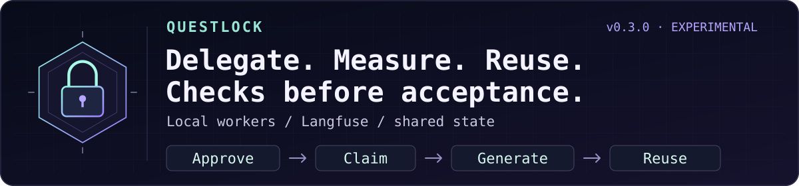

<div align="center">

# spfuzzylink

### Every abstraction is a hypothesis.

**Build something small enough to understand. Then ask it a difficult question.**

curiosity → experiment → failure → understanding

</div>

---

I’m interested in the distance between a system that works and a system whose failure I can explain.

Some questions only become clear after you build the thing. Give it a little state, a little concurrency, and an inconvenient restart. See which assumptions survive.

I like starting with the fewest moving parts I can get away with. Complexity has to earn its place. A new component should explain more than it hides.

> The most useful thing a side project can produce is a better question.

Most repositories here begin as a curiosity. Some may become useful tools. Each should leave behind a clearer understanding of how something behaves when the happy path ends.

### A few principles I keep coming back to

- Make the state visible.
- Treat failure as something to study.
- Understand the small system before growing it.
- Let evidence change the design.
- Leave enough notes for the next curious person.

---

### ☕ Currently building: Questlock



**[Questlock](https://github.com/spfuzzylink/questlock)** — a Go + SQLite experiment in reducing repeated agent work, with explicit quality gates.

It began with a stale worker trying to overwrite a newer answer. Now the question
is broader: what does it cost to finish an accepted task, and which repeated
model calls can shared state avoid?

- **Make the request inspectable.** Approve the exact context, model, limits, and snapshot before generation.
- **Delegate bounded work.** Codex and Claude Code can use a local-first MCP worker with deterministic acceptance checks. A failed check withholds the answer; an uncertain call stops.
- **Reuse valid snapshots.** Exact result reuse avoids another generation and survives broker restarts. Changed facts require a new revision.
- **Measure what happened.** Current-run phase timings, local streaming first-content/output intervals, normalized usage, and optional content-free Langfuse metadata keep fresh inference separate from retrieval.

One real MCP extraction passed strict JSON and exact-value checks using **58 input
/ 21 output tokens**. An exact repeat recovered it in **27.6 ms**, with **zero new
generation tokens**. That is one observed snapshot, not a universal speedup or an
invoice saving. The broader six-case local evaluation rejected both configurations
for failed checks; quality failures remain part of the evidence.
[Measurements and limitations](https://github.com/spfuzzylink/questlock/blob/main/docs/measurements-v0.3.0.md).

**OpenRouter routes the model. Questlock coordinates the work.**
The companion direction adds approved context, shared task admission, bounded
local delegation, and durable reuse around a routing layer. Credit to OpenRouter
for its common provider interface and caching, and to Langfuse for observability.
A selectable OpenRouter adapter remains future work; direct OpenAI, Anthropic,
and installed local Ollama adapters are available today.
[Architecture and attribution](https://github.com/spfuzzylink/questlock/blob/main/docs/model-architecture.md#openrouter-inspiration-and-possible-add-on).

**[Experimental v0.3.0](https://github.com/spfuzzylink/questlock/releases/tag/v0.3.0)** supports macOS and Linux on ARM64 and x86-64.
After [installing](https://github.com/spfuzzylink/questlock#start-the-quest), try the offline demos and evaluation:

```sh
./bin/questlock quest
./bin/questlock model quest
./bin/questlock model evaluate
```

The demos use deterministic fixtures and need no model account. Live local work
needs installed weights and the scoped broker; hardware, electricity, and time
still cost resources. Hosted chats keep their normal usage allowance.

[Delegation and MCP](https://github.com/spfuzzylink/questlock/blob/main/docs/delegation.md) ·
[Langfuse setup](https://github.com/spfuzzylink/questlock/blob/main/docs/inference-observability.md) ·
[Container](https://github.com/spfuzzylink/questlock/pkgs/container/questlock) ·
[Editable diagrams](https://github.com/spfuzzylink/questlock/blob/main/docs/model-architecture.md#editable-architecture-diagrams) ·
[Fork a failure case](https://github.com/spfuzzylink/questlock/fork)

Small enough to inspect. Useful enough to measure.

---

<div align="center">

<sub>Curiosity starts the experiment. Evidence decides what stays.</sub>

</div>
