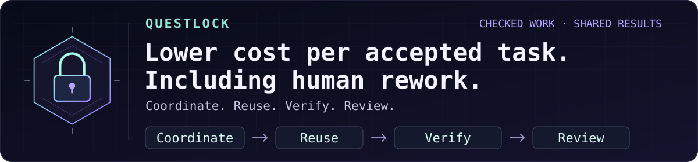

# spfuzzylink

### Every abstraction is a hypothesis.

**Build something small enough to understand. Then ask it a difficult question.**

curiosity → experiment → failure → understanding

---

I’m interested in the distance between a system that works and a system whose failure I can explain.

Some questions only become clear after you build the thing. Give it a little state, a little concurrency, and an inconvenient restart. See which assumptions survive.

I like starting with the fewest moving parts I can get away with. Complexity has to earn its place. A new component should explain more than it hides.

> The most useful thing a side project can produce is a better question.

Most repositories here begin as a curiosity. Some may become useful tools. Each should leave behind a clearer understanding of how something behaves when the happy path ends.

### A few principles I keep coming back to

- Make the state visible.
- Treat failure as something to study.
- Understand the small system before growing it.
- Let evidence change the design.
- Leave enough notes for the next curious person.

---

### ☕ Currently building: **Questlock**

You already paid for the answer. Why generate it again to change a sentence?

**[Questlock](https://github.com/spfuzzylink/questlock)** reuses completed work,
applies checked literal edits without a model, and runs bounded tasks through
local or hosted models. Optional CPU/memory-aware admission and cache-aware SGLang
integration help coordinate the work around them. Go + SQLite, small enough to inspect.
[Integration samples](https://github.com/spfuzzylink/questlock#use-it-with-what-you-already-run).

**OpenRouter routes the model. Questlock coordinates the work.** An independent
companion for the OpenRouter ecosystem, with shared task admission, reusable
results and explicit human feedback. Credit to OpenRouter, Ollama, TypeSafe, SGLang and
Langfuse for the layers they provide.

**Experimental v0.10.0** puts that coordination inside your Go app. Run workers on
one machine or several, sharing results and one daily token allowance through
a broker. Each process pauses when its own CPU or memory is under pressure;
your chosen runtime still owns the GPU.
[Wire it into Go](https://github.com/spfuzzylink/questlock/blob/main/docs/go-integration.md) ·
[Measured overhead and limits](https://github.com/spfuzzylink/questlock/blob/main/docs/execution-validation-v0.10.0.md).

**Earlier v0.9.1** got the original six local team tasks through their
answer checks and both reviewers. Five exact results were reused; the remaining
task ran three fresh local roles with an explicit output contract.

The same saved Codex baseline reports **65,800 hosted tokens**; these local
workflows use **0 hosted tokens and $0 provider API spend**, with paid fallback
disabled. That is a bounded workflow result, not a whole-chat credit claim or a
general coding benchmark. We publish failed attempts and limits too.

`questlock setup` still connects your coding client and finishes a checked first
task with zero model calls. `doctor` and guarded config recovery stay included.

Local work has no provider token bill. The surrounding hosted chat still uses
its normal allowance. The goal is less paid repetition, with quality and human
rework counted; the [validation report](https://github.com/spfuzzylink/questlock/blob/main/docs/local-team-validation-v0.9.1.md)
keeps the failures visible too.

[Get started](https://github.com/spfuzzylink/questlock/blob/main/docs/onboarding.md) ·
[Downloads](https://github.com/spfuzzylink/questlock/releases/tag/v0.10.0) ·
[Architecture](https://github.com/spfuzzylink/questlock/blob/main/docs/architecture.md) ·
[Container](https://github.com/spfuzzylink/questlock/pkgs/container/questlock) ·
[Fork it](https://github.com/spfuzzylink/questlock/fork)

---

Curiosity starts the experiment. Evidence decides what stays.

