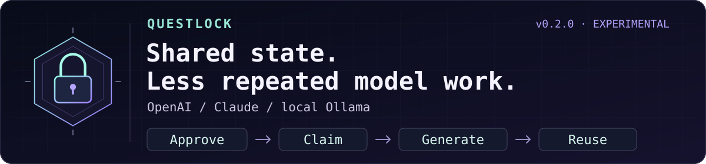

<div align="center">

# spfuzzylink

### Every abstraction is a hypothesis.

**Build something small enough to understand. Then ask it a difficult question.**

curiosity → experiment → failure → understanding

</div>

---

I’m interested in the distance between a system that works and a system whose failure I can explain.

Some questions only become clear after you build the thing. Give it a little state, a little concurrency, and an inconvenient restart. See which assumptions survive.

I like starting with the fewest moving parts I can get away with. Complexity has to earn its place. A new component should explain more than it hides.

> The most useful thing a side project can produce is a better question.

Most repositories here begin as a curiosity. Some may become useful tools. Each should leave behind a clearer understanding of how something behaves when the happy path ends.

### A few principles I keep coming back to

- Make the state visible.
- Treat failure as something to study.
- Understand the small system before growing it.
- Let evidence change the design.
- Leave enough notes for the next curious person.

---

### ☕ Currently building: Questlock



**[Questlock](https://github.com/spfuzzylink/questlock)** — a Go + SQLite experiment in shared agent state and bounded model work.

It began with a stale worker waking up and trying to overwrite a newer answer.
The next question: when several workers need the same approved answer, how many
model calls should they start?

- **Make the request inspectable.** Plan explicit approved context, preserve required chunks, and set input/output limits before generation.
- **Coordinate repeated work.** Concurrent workers claim one exact task; opted-in completed-result reuse survives a broker restart.
- **Keep spending visible.** Shared API budget reservations remain held on unknown outcomes; successful reconciliation of a measured overrun freezes that day’s ledger for review.
- **Run routine tasks locally.** Installed Ollama weights allow fresh inference without provider token bills, within your hardware, memory, time, and model-quality limits.

One measured local handoff used **366 input / 135 output tokens**. Requesting that
same snapshot again used **0 / 0 new generation tokens** and recovered the stored
answer. Reuse stays valid only while the approved snapshot remains unchanged;
update the task revision when its facts change.
[See the executed checks](https://github.com/spfuzzylink/questlock/blob/main/docs/validation.md#020-model-workflow-validation--2026-10-12).

**OpenRouter routes the model. Questlock coordinates the work.**
The intended OpenRouter add-on supplies approved context, shared task admission,
and durable reuse around its model-routing layer. Its provider interface and
caching deserve credit; the Questlock OpenRouter adapter remains future work.
[Companion architecture and attribution](https://github.com/spfuzzylink/questlock/blob/main/docs/model-architecture.md#openrouter-inspiration-and-possible-add-on).

**[v0.2.0](https://github.com/spfuzzylink/questlock/releases/tag/v0.2.0)** is available for macOS and Linux, on ARM64 and x86-64.
After [installing](https://github.com/spfuzzylink/questlock#start-the-quest), try both offline quests:

```sh
./bin/questlock quest
./bin/questlock model quest
```

The original quest exercises stale writes and crash recovery. The model quest
runs **six scenarios** with deterministic model fixtures: exact reuse, whole-chunk
context selection, cost preflight, 20 competing workers, restart/revision behavior,
and shared budgets with unknown outcomes. No model account or paid call needed.

[What, why, and how](https://github.com/spfuzzylink/questlock/blob/main/docs/model-architecture.md) ·
[Local setup](https://github.com/spfuzzylink/questlock/blob/main/docs/local-models.md) ·
[Container](https://github.com/spfuzzylink/questlock/pkgs/container/questlock) ·
[Editable diagrams](https://github.com/spfuzzylink/questlock/blob/main/docs/model-architecture.md#editable-architecture-diagrams) ·
[Fork a failure case](https://github.com/spfuzzylink/questlock/fork)

Small enough to inspect. Interesting enough to break on purpose.

---

<div align="center">

<sub>Curiosity starts the experiment. Evidence decides what stays.</sub>

</div>
